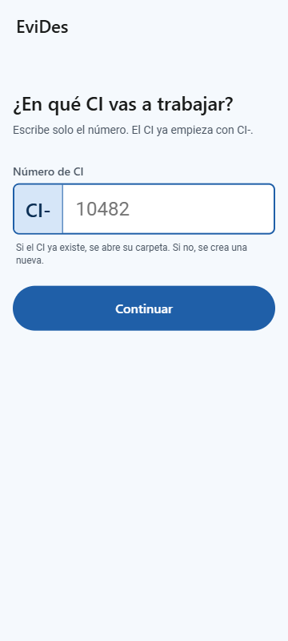
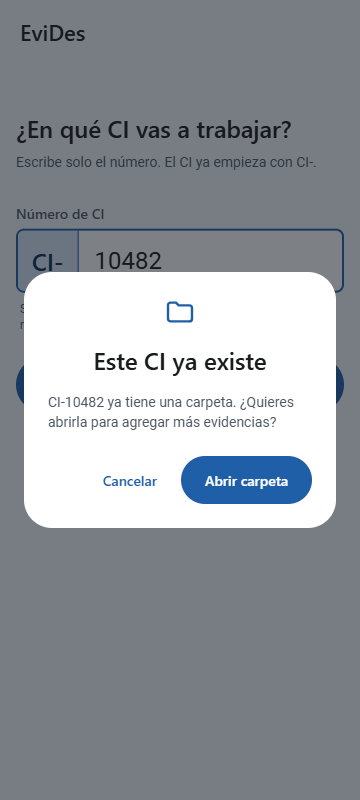
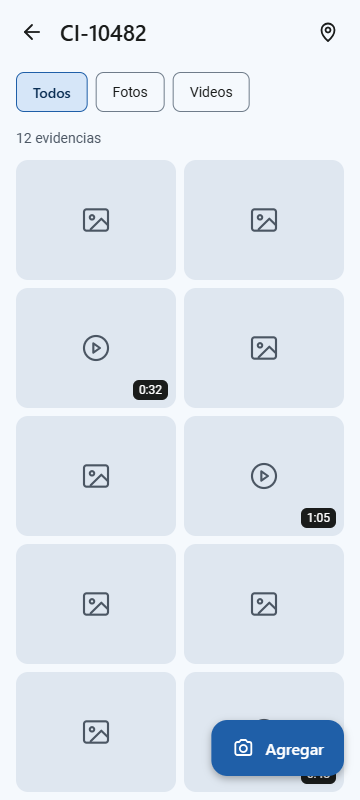
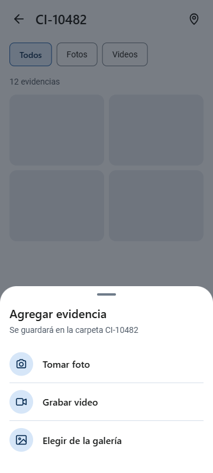
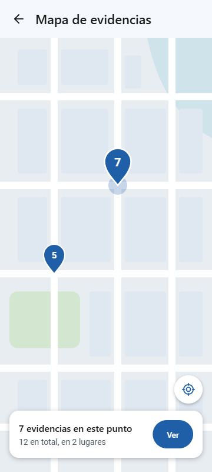
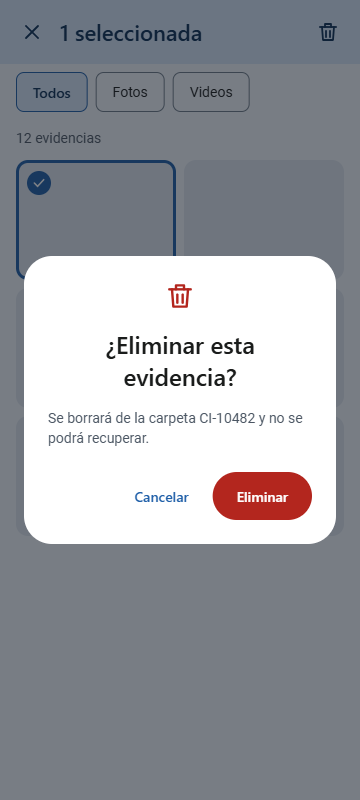

# EviDes: evidencias de despacho

App móvil para registrar y organizar las fotos y videos de evidencia de cada contenedor que sale de una planta, organizados por número de CI (control interno), con ubicación en mapa y filtros de búsqueda.

## Integrantes

- Allen Vargas Cousin (proyecto individual)

## Cómo funciona

1. El usuario escribe solo el número del CI (el prefijo "CI-" ya viene puesto).
2. Si el CI no existe, la app crea una carpeta con ese CI en el almacenamiento interno del dispositivo y empieza a guardar ahí las evidencias.
3. Si el CI ya existe (aunque sea de días atrás), la app abre esa carpeta para agregar más fotos o videos, sin crear una nueva.
4. La creación, consulta y eliminación de carpetas y evidencias se hace a nivel interno de la app, sin conexión a servidores externos.

## Funcionalidades previstas

- CRUD: crear la carpeta de un CI, consultar, agregar y eliminar evidencias
- Lista con filtros personalizados (todos, fotos, videos)
- Acceso a cámara o galería para fotos y videos
- Diálogos (CI ya existe, confirmar eliminar)
- Mapa con los lugares donde se tomaron las evidencias

## Mockups

Diseñados con Material Design 3 para Android (Android Studio). Los CI y las evidencias que se muestran son datos de ejemplo.

| 1. Inicio | 2. CI ya existe | 3. Carpeta del CI |
|---|---|---|
|  |  |  |

| 4. Agregar evidencia | 5. Mapa | 6. Confirmar eliminar |
|---|---|---|
|  |  |  |

## Visión a futuro (tentativa)

En una versión posterior, las evidencias se enviarían automáticamente a una unidad compartida (FSx), con una carpeta por CI, cuando el curso avance a ese nivel.
